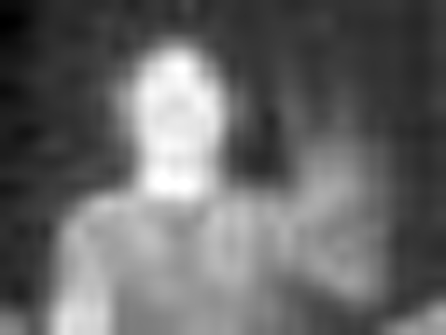
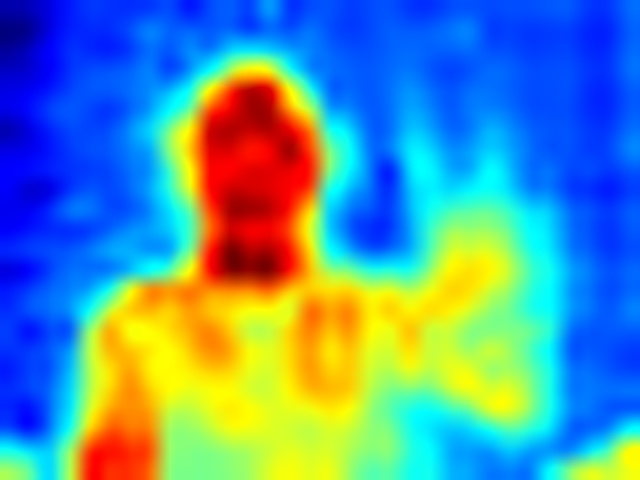

# ESP32-S3 Thermal UVC

My first project in ESP-IDF. An ESP32-S3 thermal UVC camera using the MLX90642 infrared sensor. Captures 32×24 thermal images, processes and converts them to grayscale, encodes them as JPEG, and streams the frames to a host computer over USB.

| 8-bit Grayscale Image | False-Color Image |
| :---: | :---: |
|  |  |
